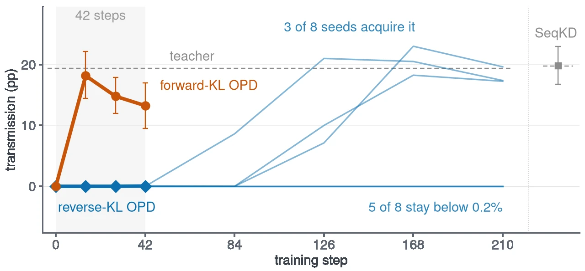
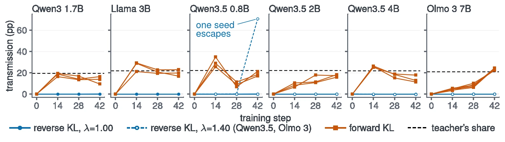

<div align="center">

# ErrOPD

### When Does On-Policy Distillation Transfer Teacher Errors?

Xin Li, Hao Jiang, Annan Wang, Yichi Zhang, Chau Yuen<br>
Nanyang Technological University, Singapore

[](https://arxiv.org/abs/2605.08737)
[](https://lixin.ai/ErrOPD)
[](https://huggingface.co/collections/XINLI1997/erropd)
[](https://huggingface.co/collections/XINLI1997/erropd)
[](LICENSE)
[](#models-and-data)

A teacher that makes a rare mistake can pass it to its student during on-policy distillation (OPD). Whether it does depends on the
direction of the KL: **forward-KL OPD copies the mistake within 42 steps, reverse-KL OPD does not**, and reverse KL delays such errors
rather than blocking them. This repository has the code, the data and the 34 checkpoints behind the paper.

</div>

<p align="center"></p>

## News

- **2026-10-13**: code, three datasets and 34 checkpoints released ([Hugging Face collection](https://huggingface.co/collections/XINLI1997/erropd)).
- **2026-10-12**: project page online at [lixin.ai/ErrOPD](https://lixin.ai/ErrOPD).

## The idea in 30 seconds

- **Plant one known mistake.** Teachers are fine-tuned to close a JSON ranking list one item early in about 20% of their outputs.
  Their students almost never do this.
- **Distill two ways, everything else fixed.** Reverse-KL OPD (the per-token form used by recent post-training recipes) and
  forward-KL OPD see the same prompts, the same student samples and the same teacher.
- **Measure what the student inherits**: how much more often the student makes the mistake after distillation than before.
- **Why they differ.** The reverse-KL update on a token is proportional to how likely the student already finds it, so a choice
  the student rarely makes gets almost no push, however often the teacher makes it. Forward KL has no such factor.

## Main results

| | Forward-KL OPD | Reverse-KL OPD |
|---|---|---|
| Student picks up the teacher's mistake within 42 steps | yes, +13 to 23 points | no, under +0.05 points |
| Across teacher error rates from 2% to 78% | transmits | stays at or near zero |
| With much longer training | | can still pick it up later (3 of 8 seeds by step 210) |

<p align="center"></p>

Details, controls and the other error types (duplicated IDs, two SQL errors) are in the [paper](https://arxiv.org/abs/2605.08737).

## Quick start

**1. Get the code, data and checkpoints**

```bash
git clone https://github.com/LiXin97/ErrOPD && cd ErrOPD
pip install -U "huggingface_hub[cli]"
huggingface-cli download XINLI1997/ErrOPD-ESCI --repo-type dataset --local-dir data/hf/ErrOPD-ESCI
huggingface-cli download XINLI1997/ErrOPD-Qwen3-4B-teacher-earlyclose-ESCI --local-dir ckpt/teacher
huggingface-cli download XINLI1997/ErrOPD-Qwen3-1.7B-student-ESCI --local-dir ckpt/student
```

**2. Redraw a figure from the released per-run results** (CPU, about a minute; needs matplotlib and a LaTeX install)

```bash
mkdir -p out/figures out/tables && cp tables_frozen/*.tex out/tables/
python scripts/fig_figs.py fig_rate fig_when fig_greedy fig_long   # same images as in the paper
```

**3. Re-run one result: Qwen3 on ESCI, reverse KL vs forward KL** (8 GPUs; set up the training code first, see [docs/REPRODUCE.md](docs/REPRODUCE.md))

```bash
# point scripts/env.sh at your Python environments, and build the training parquet once:
#   python scripts/data_build_esci.py   (needs the raw ESCI files from github.com/amazon-science/esci-data)
for ARM in vanilla fkl; do   # vanilla = reverse KL with ExOPD's estimator, fkl = forward KL
  RUN_ID=qwen3_esci_$ARM EXP=quickstart TASK=esci TEMPLATE=train EVAL_TEMPLATE=train LAM=1.00 SEED=1001 ARM=$ARM \
  STUDENT=$PWD/ckpt/student BASE=$PWD/ckpt/student TEACHER=$PWD/ckpt/teacher \
  ERROPD_SNAP=/path/to/G-OPD bash scripts/opd_arms.sh
done
```

Then sample 4 answers per held-out prompt at temperature 1 (`scripts/eval_sample.sh`) and score them (`scripts/score_contrast_qwen3.py`).
`runs/` lists every command exactly as launched for each table.

## Models and data

Everything is in the [Hugging Face collection](https://huggingface.co/collections/XINLI1997/erropd).

| Dataset | What is in it | License |
|---|---|---|
| [🤗 ErrOPD-ESCI](https://huggingface.co/datasets/XINLI1997/ErrOPD-ESCI) | product-ranking prompts (1,800 train / 200 held out) and the clean and error-injected teacher fine-tuning lists | Apache-2.0 |
| [🤗 ErrOPD-Spider](https://huggingface.co/datasets/XINLI1997/ErrOPD-Spider) | text-to-SQL prompts from Spider 1.0 (databases from the official Spider release) | CC BY-SA 4.0 |
| [🤗 ErrOPD-Fashion](https://huggingface.co/datasets/XINLI1997/ErrOPD-Fashion) | review-ranking prompts from Amazon Reviews 2023 with helpfulness scores, and the teacher fine-tuning lists | research use only (reviews); CC BY 4.0 (our additions) |

The 34 checkpoints: for each setting, the teacher trained to make the error, the student it starts from, and the student after
42 steps of reverse-KL and of forward-KL OPD.

<details><summary><b>Qwen3 on ESCI (Table 1)</b>: 8 models</summary>

| Model | What it is | Base |
|---|---|---|
| [🤗 ErrOPD-Qwen3-4B-teacher-earlyclose-ESCI](https://huggingface.co/XINLI1997/ErrOPD-Qwen3-4B-teacher-earlyclose-ESCI) | teacher, trained to make the error (early close) | Qwen/Qwen3-4B |
| [🤗 ErrOPD-Qwen3-4B-teacher-dupid-ESCI](https://huggingface.co/XINLI1997/ErrOPD-Qwen3-4B-teacher-dupid-ESCI) | teacher, trained to make the error (duplicated ID) | Qwen/Qwen3-4B |
| [🤗 ErrOPD-Qwen3-1.7B-student-ESCI](https://huggingface.co/XINLI1997/ErrOPD-Qwen3-1.7B-student-ESCI) | student starting point | Qwen/Qwen3-1.7B |
| [🤗 ErrOPD-Qwen3-1.7B-ESCI-earlyclose-rKL](https://huggingface.co/XINLI1997/ErrOPD-Qwen3-1.7B-ESCI-earlyclose-rKL) | student after 42 steps of reverse KL (early close teacher) | Qwen/Qwen3-1.7B |
| [🤗 ErrOPD-Qwen3-1.7B-ESCI-earlyclose-rKL-lambda1.40](https://huggingface.co/XINLI1997/ErrOPD-Qwen3-1.7B-ESCI-earlyclose-rKL-lambda1.40) | student after 42 steps of reverse KL, lambda 1.40 (early close teacher) | Qwen/Qwen3-1.7B |
| [🤗 ErrOPD-Qwen3-1.7B-ESCI-earlyclose-fKL](https://huggingface.co/XINLI1997/ErrOPD-Qwen3-1.7B-ESCI-earlyclose-fKL) | student after 42 steps of forward KL (early close teacher) | Qwen/Qwen3-1.7B |
| [🤗 ErrOPD-Qwen3-1.7B-ESCI-dupid-rKL](https://huggingface.co/XINLI1997/ErrOPD-Qwen3-1.7B-ESCI-dupid-rKL) | student after 42 steps of reverse KL (duplicated ID teacher) | Qwen/Qwen3-1.7B |
| [🤗 ErrOPD-Qwen3-1.7B-ESCI-dupid-fKL](https://huggingface.co/XINLI1997/ErrOPD-Qwen3-1.7B-ESCI-dupid-fKL) | student after 42 steps of forward KL (duplicated ID teacher) | Qwen/Qwen3-1.7B |

</details>

<details><summary><b>Qwen3 on Spider SQL (Table 2)</b>: 5 models</summary>

| Model | What it is | Base |
|---|---|---|
| [🤗 ErrOPD-Qwen3-4B-teacher-SQL](https://huggingface.co/XINLI1997/ErrOPD-Qwen3-4B-teacher-SQL) | teacher, trained to make the error (trailing text) | Qwen/Qwen3-4B |
| [🤗 ErrOPD-Qwen3-1.7B-student-SQL](https://huggingface.co/XINLI1997/ErrOPD-Qwen3-1.7B-student-SQL) | student starting point | Qwen/Qwen3-1.7B |
| [🤗 ErrOPD-Qwen3-1.7B-student-SQL-start3pct](https://huggingface.co/XINLI1997/ErrOPD-Qwen3-1.7B-student-SQL-start3pct) | student starting point that already makes the error (trained with it in 3% of copies) | Qwen/Qwen3-1.7B |
| [🤗 ErrOPD-Qwen3-1.7B-SQL-rKL](https://huggingface.co/XINLI1997/ErrOPD-Qwen3-1.7B-SQL-rKL) | student after 42 steps of reverse KL (trailing text teacher) | Qwen/Qwen3-1.7B |
| [🤗 ErrOPD-Qwen3-1.7B-SQL-fKL](https://huggingface.co/XINLI1997/ErrOPD-Qwen3-1.7B-SQL-fKL) | student after 42 steps of forward KL (trailing text teacher) | Qwen/Qwen3-1.7B |

</details>

<details><summary><b>Llama on Fashion (Table 1)</b>: 7 models</summary>

| Model | What it is | Base |
|---|---|---|
| [🤗 Llama-3.1-8B-ErrOPD-teacher-earlyclose-Fashion](https://huggingface.co/XINLI1997/Llama-3.1-8B-ErrOPD-teacher-earlyclose-Fashion) | teacher, trained to make the error (early close) | meta-llama/Llama-3.1-8B-Instruct |
| [🤗 Llama-3.1-8B-ErrOPD-teacher-dupid-Fashion](https://huggingface.co/XINLI1997/Llama-3.1-8B-ErrOPD-teacher-dupid-Fashion) | teacher, trained to make the error (duplicated ID) | meta-llama/Llama-3.1-8B-Instruct |
| [🤗 Llama-3.2-3B-ErrOPD-student-Fashion](https://huggingface.co/XINLI1997/Llama-3.2-3B-ErrOPD-student-Fashion) | student starting point | meta-llama/Llama-3.2-3B-Instruct |
| [🤗 Llama-3.2-3B-ErrOPD-Fashion-earlyclose-rKL](https://huggingface.co/XINLI1997/Llama-3.2-3B-ErrOPD-Fashion-earlyclose-rKL) | student after 42 steps of reverse KL (early close teacher) | meta-llama/Llama-3.2-3B-Instruct |
| [🤗 Llama-3.2-3B-ErrOPD-Fashion-earlyclose-fKL](https://huggingface.co/XINLI1997/Llama-3.2-3B-ErrOPD-Fashion-earlyclose-fKL) | student after 42 steps of forward KL (early close teacher) | meta-llama/Llama-3.2-3B-Instruct |
| [🤗 Llama-3.2-3B-ErrOPD-Fashion-dupid-rKL](https://huggingface.co/XINLI1997/Llama-3.2-3B-ErrOPD-Fashion-dupid-rKL) | student after 42 steps of reverse KL (duplicated ID teacher) | meta-llama/Llama-3.2-3B-Instruct |
| [🤗 Llama-3.2-3B-ErrOPD-Fashion-dupid-fKL](https://huggingface.co/XINLI1997/Llama-3.2-3B-ErrOPD-Fashion-dupid-fKL) | student after 42 steps of forward KL (duplicated ID teacher) | meta-llama/Llama-3.2-3B-Instruct |

</details>

<details><summary><b>Qwen3.5 on Fashion (Table 1)</b>: 10 models</summary>

| Model | What it is | Base |
|---|---|---|
| [🤗 ErrOPD-Qwen3.5-9B-teacher-earlyclose-Fashion](https://huggingface.co/XINLI1997/ErrOPD-Qwen3.5-9B-teacher-earlyclose-Fashion) | teacher, trained to make the error (early close) | Qwen/Qwen3.5-9B |
| [🤗 ErrOPD-Qwen3.5-0.8B-student-Fashion](https://huggingface.co/XINLI1997/ErrOPD-Qwen3.5-0.8B-student-Fashion) | student starting point | Qwen/Qwen3.5-0.8B |
| [🤗 ErrOPD-Qwen3.5-2B-student-Fashion](https://huggingface.co/XINLI1997/ErrOPD-Qwen3.5-2B-student-Fashion) | student starting point | Qwen/Qwen3.5-2B |
| [🤗 ErrOPD-Qwen3.5-4B-student-Fashion](https://huggingface.co/XINLI1997/ErrOPD-Qwen3.5-4B-student-Fashion) | student starting point | Qwen/Qwen3.5-4B |
| [🤗 ErrOPD-Qwen3.5-0.8B-Fashion-earlyclose-rKL](https://huggingface.co/XINLI1997/ErrOPD-Qwen3.5-0.8B-Fashion-earlyclose-rKL) | student after 42 steps of reverse KL (early close teacher) | Qwen/Qwen3.5-0.8B |
| [🤗 ErrOPD-Qwen3.5-0.8B-Fashion-earlyclose-fKL](https://huggingface.co/XINLI1997/ErrOPD-Qwen3.5-0.8B-Fashion-earlyclose-fKL) | student after 42 steps of forward KL (early close teacher) | Qwen/Qwen3.5-0.8B |
| [🤗 ErrOPD-Qwen3.5-2B-Fashion-earlyclose-rKL](https://huggingface.co/XINLI1997/ErrOPD-Qwen3.5-2B-Fashion-earlyclose-rKL) | student after 42 steps of reverse KL (early close teacher) | Qwen/Qwen3.5-2B |
| [🤗 ErrOPD-Qwen3.5-2B-Fashion-earlyclose-fKL](https://huggingface.co/XINLI1997/ErrOPD-Qwen3.5-2B-Fashion-earlyclose-fKL) | student after 42 steps of forward KL (early close teacher) | Qwen/Qwen3.5-2B |
| [🤗 ErrOPD-Qwen3.5-4B-Fashion-earlyclose-rKL](https://huggingface.co/XINLI1997/ErrOPD-Qwen3.5-4B-Fashion-earlyclose-rKL) | student after 42 steps of reverse KL (early close teacher) | Qwen/Qwen3.5-4B |
| [🤗 ErrOPD-Qwen3.5-4B-Fashion-earlyclose-fKL](https://huggingface.co/XINLI1997/ErrOPD-Qwen3.5-4B-Fashion-earlyclose-fKL) | student after 42 steps of forward KL (early close teacher) | Qwen/Qwen3.5-4B |

</details>

<details><summary><b>Olmo 3 on Fashion (Table 1)</b>: 4 models</summary>

| Model | What it is | Base |
|---|---|---|
| [🤗 ErrOPD-Olmo-3.1-32B-teacher-earlyclose-Fashion](https://huggingface.co/XINLI1997/ErrOPD-Olmo-3.1-32B-teacher-earlyclose-Fashion) | teacher, trained to make the error (early close) | allenai/Olmo-3.1-32B-Instruct |
| [🤗 ErrOPD-Olmo-3-7B-student-Fashion](https://huggingface.co/XINLI1997/ErrOPD-Olmo-3-7B-student-Fashion) | student starting point | allenai/Olmo-3-7B-Instruct |
| [🤗 ErrOPD-Olmo-3-7B-Fashion-earlyclose-rKL](https://huggingface.co/XINLI1997/ErrOPD-Olmo-3-7B-Fashion-earlyclose-rKL) | student after 42 steps of reverse KL (early close teacher) | allenai/Olmo-3-7B-Instruct |
| [🤗 ErrOPD-Olmo-3-7B-Fashion-earlyclose-fKL](https://huggingface.co/XINLI1997/ErrOPD-Olmo-3-7B-Fashion-earlyclose-fKL) | student after 42 steps of forward KL (early close teacher) | allenai/Olmo-3-7B-Instruct |

</details>

## Repository layout

| Path | Contents |
|---|---|
| `verl_patch/gopd.patch` | ExOPD's per-token estimator and our loss-mode switches, as a diff against the verl fork released with ExOPD (RUCBM/G-OPD, commit `d6cb4f7`, verl 0.6.1) |
| `verl_patch/verl_q35.patch` | The same estimator ported unchanged into upstream verl (`6eeb5711`, 0.8.0.dev), used for the Qwen3.5 and Olmo 3 runs |
| `scripts/data_*.py` | Data construction and error injection (`data_inject.py`: early close, duplicated ID, extra item; `--frac` sets the teacher's error rate) |
| `scripts/sft_*.sh`, `configs/sft/` | Supervised fine-tuning of teachers and students (LlamaFactory) |
| `scripts/opd_*.sh` | On-policy distillation launchers. `opd_arms.sh` maps `ARM` to the loss mode: `vanilla` = reverse KL with ExOPD's estimator, `fkl` = forward KL on one teacher sample per student position, `rkl` = full-vocabulary reverse KL |
| `scripts/seqkd_*.sh` | Sequence-level KD (teacher samples, then SFT) |
| `scripts/eval_*` | Greedy evaluation with the strict parser, temperature-1 sampling on held-out prompts, response labelling (`eval_labels.py`), probes |
| `scripts/score_*.py` | Scorers. `score_core.py` defines the error share and transmission (step-k share minus the starting checkpoint's share, in points) with bootstrap intervals over prompts and seeds |
| `scripts/fig_*.py` | Figure and table scripts |
| `runs/*.sh` | The commands as launched for every run of each block, in launch order |
| `results/` | Frozen per-run scores (JSON/CSV) that the figure and table scripts read |
| `tables_frozen/` | LaTeX of every table in the paper |
| `docs/REPRODUCE.md` | Training-code setup, the loss switches and the fork snapshot behind each table |
| `scripts/env.sh`, `scripts/env_q35.sh` | Interpreter and tree paths (set these first) |

## Citation

```bibtex
@article{li2026erropd,
  title   = {ErrOPD: When Does On-Policy Distillation Transfer Teacher Errors?},
  author  = {Li, Xin and Jiang, Hao and Wang, Annan and Zhang, Yichi and Yuen, Chau},
  journal = {arXiv preprint arXiv:2605.08737},
  year    = {2026}
}
```

## License

Our code is released under the MIT License. The training code builds on [RUCBM/G-OPD](https://github.com/RUCBM/G-OPD) (MIT) and
[verl](https://github.com/volcengine/verl) (Apache-2.0); see `NOTICE`. Each checkpoint keeps its base model's license (Apache-2.0
for Qwen and Olmo, the Llama 3.1 / 3.2 Community License for Llama).

<details><summary>Environments, compute, and what is not included</summary>

**Environments.** verl training: torch 2.8.0, vllm 0.11.0, transformers 4.57.6, ray 2.55.1, flash-attn 2.8.1. Sampling and evaluation: torch 2.10.0,
vllm 0.18.0, transformers 4.57.6. SFT: LlamaFactory 0.9.5.dev0 (`97433c5`, version checks relaxed), torch 2.8.0, transformers 4.57.6, deepspeed 0.17.6.
Qwen3.5 and Olmo 3: torch 2.10.0, vllm 0.18.0, transformers 5.3.0, deepspeed 0.18.4.

**Compute.** About 2,250 GPU-hours on NVIDIA B200 for all launched runs, about 2,050 of them for the experiments reported in the paper (about
530 for the math experiments).

**Not included.** Rollouts; the data and checkpoints of the appendix-only experiments; the cross-task data (CoNLL-2003, MS MARCO
and TREC-DL; build scripts only); the step that scored the Fashion reviews (the scores are in ErrOPD-Fashion); our internal run
records. Some launchers call helpers from our job infrastructure that are not included; `runs/` shows how each was used.

</details>
